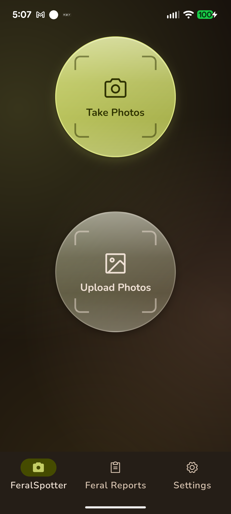
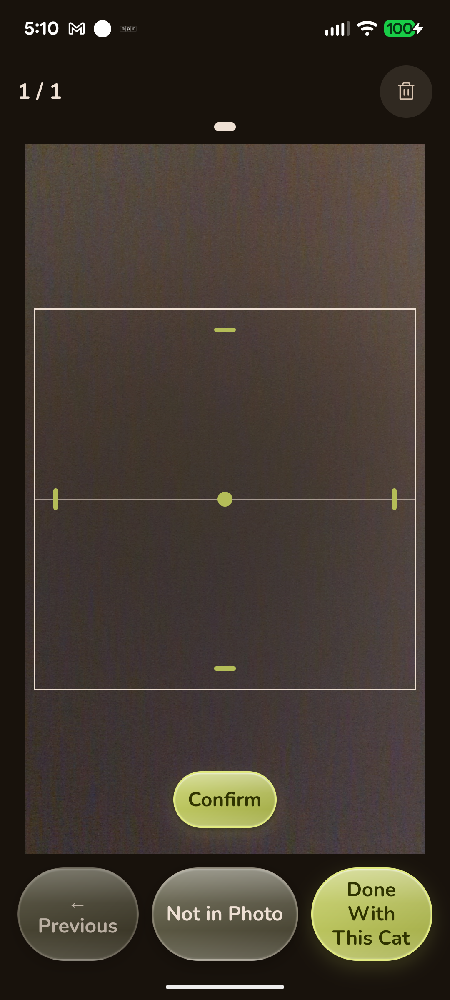

# FeralSpotter

FeralSpotter is a mobile app for recording feral cat sightings. Add photos, mark the cats in each photo, and record the location and details you notice.

The app is in **alpha development**. Android is the current test-drive target; iOS needs separate build and device verification. There is no public store download linked here yet.

## Record a sighting

1. Review the first-run data disclosure and permission prompts, then sign in with Google or email. You can also create an email account. Apple and Facebook sign-in are gated to a future release.
2. On Home, choose **Take Photos** or **Upload Photos** to select pictures from your library. A sighting uses one photo source at a time; finish or reset the current draft before switching sources.
3. Draw and confirm a box around the same cat in each relevant photo. Use **Not in Photo** where that cat is absent, then **Done With This Cat** to describe it. Leave attributes unknown when you are unsure.
4. Add other cats as needed. Review the sighting's location and time, correcting them if necessary.
5. Choose **Submit Sighting**, review the cat/photo counts, and confirm. At least one cat and one photo are required. If sending fails, the draft stays on this device so you can retry.

The **Sightings** tab lists local draft and submitted records. You can continue the current draft there. **Reset** clears the draft; copies already saved to your camera roll remain there.

Photos can upload in the background as you add them, before final submission. Final submission sends the sighting metadata. Email updates and usage analytics have separate opt-in choices. Where organization choices are available, they record sharing permissions; automatic delivery to rescue groups is not implemented yet. Read the disclosure in the app before contributing.

## Screenshots

These Android captures from October 28, 2026 show Home and annotation controls with a test photo. They are historical previews; labels and styling may differ from the current build.

  
  

## Contributing

See the [contributing guide](CONTRIBUTING.md) to set up local builds, run checks, or report a bug.
