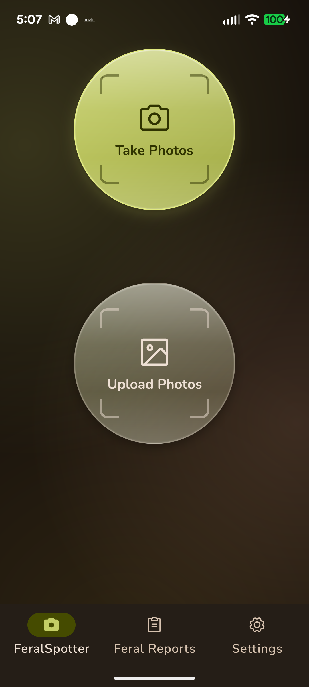
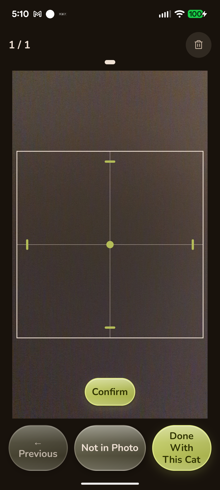

# FeralSpotter

FeralSpotter is a mobile app for recording feral cat sightings. Add photos, mark the cats in each photo, and record the location and details you notice.

The app is in **alpha development**. Android is the current test-drive target; iOS needs separate build and device verification. There is no public store download linked here yet.

## Record a sighting

1. Review the first-run data disclosure and permission prompts, then sign in with Google or email. You can also create an email account. Apple and Facebook sign-in are gated to a future release.
2. On Home, choose **Take Photos** or **Upload Photos** to select pictures from your library. A sighting uses one photo source at a time; finish or reset the current draft before switching sources.
3. Draw and confirm a box around the same cat in each relevant photo. Use **Not in Photo** where that cat is absent, then **Done With This Cat** to describe it. Leave attributes unknown when you are unsure.
4. Add other cats as needed. Review the sighting's location and time, correcting them if necessary.
5. Choose **Submit Sighting**, review the cat/photo counts, and confirm. At least one cat and one photo are required. If sending fails, the draft stays on this device so you can retry.

The **Sightings** tab lists local draft and submitted records. You can continue the current draft there. **Reset** clears the draft; copies already saved to your camera roll remain there.

Photos can upload in the background as you add them, before final submission. Final submission sends the sighting metadata. Email updates and usage analytics have separate opt-in choices. Where organization choices are available, they record sharing permissions; automatic delivery to rescue groups is not implemented yet. Read the disclosure in the app before contributing.

## Screenshots

These Android captures from October 28, 2026 show Home and annotation controls with a test photo. They are historical previews; labels and styling may differ from the current build.

<p>
  
  
</p>

## Develop locally

The app uses Expo SDK 58, React Native 0.88, TypeScript 6, Expo Router, Zustand, Unistyles, and Firebase Auth/Storage/Firestore (Firestore server-side only, for organizations). Native camera and other modules require a development build; Expo Go is insufficient.

Prerequisites:

- Node.js **24.x** and npm.
- Android SDK/build tools and a connected device or emulator for Android; macOS and Xcode for iOS.
- A JDK compatible with the native build toolchain. The Firebase emulator rules lane uses JDK 21.
- Project-specific Firebase native configuration (`google-services.json` / `GoogleService-Info.plist`) and provider setup for real sign-in. Obtain these from the maintainer; do not commit private credentials.

```bash
npm ci
cp .env.example .env.local
```

Configure the environment for the intended backend mode. Use the [local Firebase emulator instructions](docs/agents/backend.md#test-drive-posture-emulator-by-default) for Auth/Storage testing without production data. Fully offline development stubs are also available with `EXPO_PUBLIC_AUTH_MOCK=true` and `EXPO_PUBLIC_UPLOADS_MOCK=true`; those do not validate Firebase behavior.

```bash
npx expo prebuild --clean
npx expo run:android
# macOS, after completing iOS native configuration:
npx expo run:ios
```

`prebuild --clean` regenerates the native projects; put persistent native changes in config plugins or local modules. See [native development guidance](docs/agents/native-code.md). The `npm run android` wrapper additionally clears the Android app's local data before launching; use it only when you intend to reset that installation.

## Check changes

```bash
npm run typecheck
npx expo lint
npm test -- --runInBand
npm run test:rules
npm ci --prefix functions
npm run test:functions -- --runInBand
```

The rules command starts local Auth/Storage/Firestore emulators and tests the repository's rules. Native camera, permission, layout, and sign-in behavior still need device testing; passing Jest does not verify those seams.

See [project structure](docs/PROJECT_STRUCTURE.md), the [manual QA checklist](docs/qa_checklist.md), and [open issues](https://github.com/matthewdmanning/feral-spotter/issues) for architecture, validation, and remaining work. Report a bug with the build/commit, device, reproduction steps, and expected versus observed behavior.
